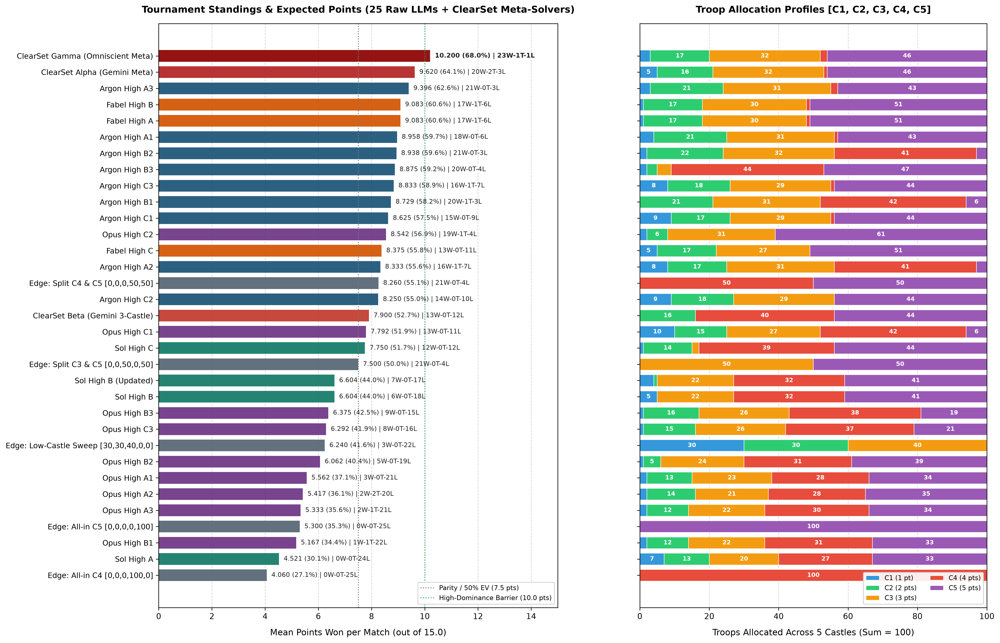
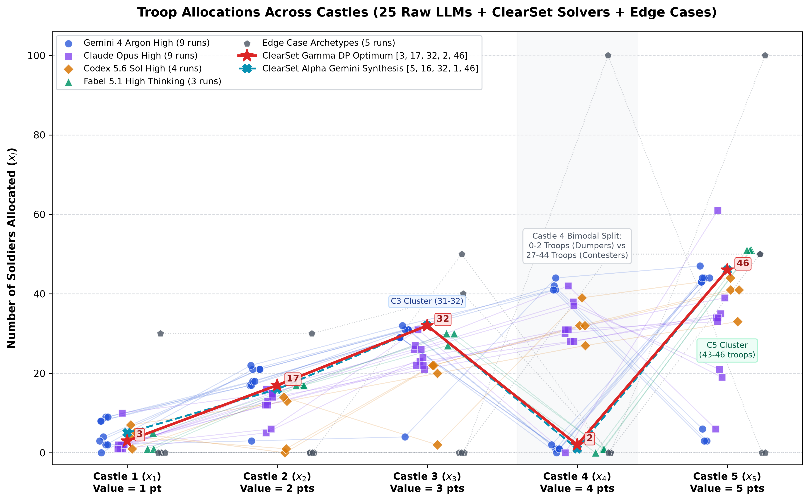

# The problem
> You have 100 soldiers to split across 5 castles, worth 1, 2, 3, 4 and 5 points. Whole numbers only, adding up to exactly 100. Your allocation is matched against every other applicant's. In each matchup, whoever sends more soldiers to a castle wins its points; a tie splits them. Your score is your average across all matchups.

Again note:
- Your final score is the average across ALL matchups
- you still gain points even in a loss
- Tie increases point average 

Instead of running full 5-castle simulations against every opponent, tournament scoring breaks down castle by castle.

For each castle, your average score against the pool is:
$$
\text{Castle Points} = (\text{Castle Value} \times \text{Win Rate}) + (0.5 \times \text{Castle Value} \times \text{Tie Rate})
$$

For example, take Castle 3 (worth 3 points). If sending 32 soldiers beats $80\%$ of opponents and ties $10\%$, your average score on Castle 3 is:
$$
(3 \times 0.80) + (1.5 \times 0.10) = 2.40 + 0.15 = 2.55 \text{ points}
$$

In code, this is calculated directly without simulating pairwise matches:

```python
total_score = 0
for castle, value in enumerate([1, 2, 3, 4, 5]):
    wins = count(my_troops[castle] > opp_troops[castle])
    ties = count(my_troops[castle] == opp_troops[castle])
    total_score += value * (wins + 0.5 * ties) / num_opponents
```


# Winning hands
A friend when talking about this problem pointed out that it's a [Colonel Blotto](https://en.wikipedia.org/wiki/Blotto_game) game using an array size of 5: 
$$
S = [x_{1},x_{2},x_{3},x_{4},x_{5}]
$$
Where $x_i \in [0,100]$ and the sum of $x_1 + ... + x_5 = 100$.

To start off on an easier problem we can just think of single matches. We define $p\geq 8$ as the minimum score to win, where winning is when the opponent in a single match gains more points than the other (of course, this doesn't matter across the board as it's the points won across all matches).

Then the possible winning indices (what we will now call hands) must be the following 16 combinations. The following numbers below represent $x_i$, where $i=$ number listed
```
{
  "4, 5": 9,
  "3, 5": 8,
  "3, 4, 5": 12,
  "2, 4, 5": 11,
  "1, 4, 5": 10,
  "2, 3, 5": 10,
  "1, 3, 5": 9,
  "2, 3, 4": 9,
  "1, 2, 5": 8,
  "1, 3, 4": 8,
  "2, 3, 4, 5": 14,
  "1, 3, 4, 5": 13,
  "1, 2, 4, 5": 12,
  "1, 2, 3, 5": 11,
  "1, 2, 3, 4": 10,
  "1, 2, 3, 4, 5": 15
}
```
We see if the winner were to win $x_4$ but not $x_5$ then they are left with $[2,3,4] \vee [1,3,4] \vee [1,2,3,4]$, whereas winning only $x_5$ results in 4 winning hands: $[3,5] \vee [2,3,5] \vee [1,3,5] \vee [1,2,5]$. 

Of the 7 winning hands that don't take both $x_4$ and $x_5$, $x_3$ is in almost every hand except $[1,2,5]$. This somewhat shows how much each castle will be fought over (and thus soldiers assigned to each) ranked in matters of importance `5,3,4,2,1`.

Additionally, there are 15 possible tie configurations that give exactly 7.5 points:
- Single-castle ties: `[2, 5, tie 1]`, `[3, 4, tie 1]`, `[1, 5, tie 3]`, `[2, 4, tie 3]`, `[1, 4, tie 5]`, `[2, 3, tie 5]`.
- Multi-castle ties: `[tie 1, 2, 3, 4, 5]`, `[3, tie 4, 5]`, `[4, tie 2, 5]`, `[5, tie 2, 3]`, `[5, tie 1, 4]`, `[1, 4, tie 2, 3]`, `[1, 3, tie 2, 5]`, `[1, 2, tie 4, 5]`, `[2, 3, tie 1, 4]`.
## Possible Action Spaces
Before starting any tests and code I wanted to try and define several subsets within possible troop distributions.

We define the set of all possible inputs to $S$ as $A$, the number of soldiers per index. Then subsets in $A$ which *should* be expected are:
- $B$:  $\forall x_i \geq 1$ : All indices targeted to win or tie must have at least 1 soldier. 
	- I had originally defined every space to hold at least one soldier, but given the winning combinations it made more sense that some slots could remain a 0.
- $C$: There must exist some subset $C$ which only contains the "correct" solutions bounded by  $p \geq 8$
	- Trivially, $[100,0,0,0,0] \notin C$
	- Additionally, $x_1 \leq 33$ because any winning hand with Castle 1 takes at least 3 castles (like $[1,4,5]$ or $[1,3,4]$), so an even split sends at most $\frac{100}{3} \approx 33.3$ soldiers to $x_1$. Hands without Castle 1 can win with just 2 castles ($[4,5]$ or $[3,5]$).
	- If $x_5$ has the most allocated, then $x_5 + x_3 <35$, leaving $x_1+x_2+x_4=65$
		- Else if $x_4$ has the most allocated then $x_4 + x_3 < 35$, leaving $x_1+x_2+x_5=65$

So $C \subset B \subset A$. We want to find an allocation in $C$, for example:
$$
\begin{gather*}
C_{1} = [1,1,18,40,40]
\\
\text{Additionally,}
\\
C_{2} = [0,0,0,50,50]
\end{gather*}
$$
As a possible answer we could submit. Countering $C_2$ requires placing $x_4 \vee x_5 > 50$ but doesn't guarantee a high average across all matchups. This still leaves us with almost 3.5 million possible actions one could take, but we can trim our answers down a little more for those relying on LLMs.
# Further Experimentation

## Player groups and allocation predictions
LLMs have historically been weighted to favour certain answers in blotto games, with a fairly famous example being from [Not Yet: Humans Outperform LLMs in a Colonel Blotto Tournament](https://arxiv.org/html/2605.22095v1). While these answers can be considered dated, they still show that models cluster around predictable patterns.

We can assume there are around four types of players in this game:
1) One shot LLM users. These users simply stick the entire prompt into an LLM, and ask it for its reasoning. Smallest group of players.
2) The same as above, except they will likely grill the LLMs a little more. Likely largest group of players.
3) Little to no LLM assistance. A few players, likely near the multi step LLM users.
4) Players like me with multi step LLM prompts and testing various models. An unknown % of players.

Hence, where (3) is impossible to predict, (1),(2),(4) are all somewhat possible to simulate in a mock game with dynamic programming. We propose a full testing framework against state of the art frontier LLM models. 

### Testing Framework
This problem sort of becomes a benchmarking framework of how all LLM models stack up against each other, though isn't exactly a great way to go about benchmarking them. To start, we feed all frontier LLMs three different prompts in a clean context window. We then rank them against each other and finally come up with an answer knowing what frontier models will output. 

We used four frontier LLMs, all on high thinking:
1) 5.1 Fabel (Claude Code CLI)
2) 4 Argon (antigravity)
3) 5.6 Sol (codex CLI)
4) Opus (antigravity)

Additionally we gave three prompts to all models:
1) Zero previous context, just the problem statement
2) (1) but telling the model that opponents are other frontier reasoning LLMs 
3) Unconstrained token limit with subagent debates, multi-turn reasoning, and coding ability (though (1) and (2) had the option to but not suggested to).

Initially I had thought to run each prompt multiple times (upwards of 50 tries), however, due to token limits, this was dropped. Additionally, given how all models are cloud hosted, they are subject to change daily (Chen et al., 2024; Atil et al., 2024) and thus would not be a good representation of LLM variation (it would be a cool paper to consider though).

Once the answers were collected we pitted all submissions against each other. We did not simulate any human answers given the complexity in mimicking that dataset. There were a few universities who posted pre round scoreboards which may have been a good way to test against other players, however, it would require players disclosing which category they belonged to. 
 
Finally we feed these findings through our custom framework [clearset](https://github.com/Core310/clearset) via Argon and analyze the previous answers. Our goal is to come up with a deterministic but accurate reading of our 4 groups of players. The full experiment setup can be found in Appendix C: Test Setup. 
### Test Results
Gemini Argon and Opus were both evaluated across 3 prompts (3 trials each, 9 total runs per model). 5.6 Sol and Fabel 5.1 High Thinking were evaluated across Prompt A, B, and C with 1 run each (plus an updated Prompt B run for Sol, so 7 outputs and 25 total submissions). The exact prompts are outlined within Appendix B. Below denotes the best and worst allocations for each model. See Appendix D for the full score table. 

The output is as follows:
- Best / Worst answers, answer, (rank,average score,points,Win Tie Loss), strategy as told by the LLM.
#### Gemini 4 Argon High
- Best (Prompt A3): `[3, 21, 31, 2, 43]` (Rank 1 / 25, 9.396 / 15.0 pts, 21W-0T-3L). Overloads Castles 2, 3, and 5 with precision thresholds while keeping small bids on Castles 1 and 4 to catch dumpers.
- Worst (Prompt C2): `[9, 18, 29, 0, 44]` (Rank 13 / 25, 8.250 / 15.0 pts, 14W-0T-10L). Concedes Castle 4 outright, leaving it vulnerable to players holding Castle 4.

#### Fabel 5.1 High Thinking
- Best (Prompt A / B): `[1, 17, 30, 1, 51]` (Rank 2 and 3 / 25, 9.083 / 15.0 pts, 17W-1T-6L). Concedes Castle 4, buys Castles 1-3 with margins above typical allocations, and puts 51 on Castle 5 to defeat standard 35-50 stacks.
- Worst (Prompt C): `[5, 17, 27, 0, 51]` (Rank 11 / 25, 8.375 / 15.0 pts, 13W-0T-11L). Concedes Castle 4 outright while bidding 5 on Castle 1, 17 on Castle 2, 27 on Castle 3, and 51 on Castle 5.

#### Claude Opus High
- Best (Prompt C2): `[2, 6, 31, 0, 61]` (Rank 10 / 25, 8.542 / 15.0 pts, 19W-1T-4L). Heavily stacks Castle 5 (61) and Castle 3 (31), completely conceding Castle 4.
- Worst (Prompt B1): `[2, 12, 22, 31, 33]` (Rank 24 / 25, 5.167 / 15.0 pts, 1W-1T-22L). Clings to near-proportional spreads, falling just below critical thresholds on Castles 2, 4, and 5.

#### Codex 5.6 Sol High
- Best (Prompt C): `[1, 14, 2, 39, 44]` (Rank 15 / 25, 7.750 / 15.0 pts, 12W-0T-12L). Focuses on Castles 4 and 5, but wastes 2 soldiers on Castle 3.
- Worst (Prompt A): `[7, 13, 20, 27, 33]` (Rank 25 / 25, 4.521 / 15.0 pts, 0W-0T-24L). Pure proportional division that achieves 0 wins across the entire 25-entry benchmark.

#### Outcomes
Full standings are in Appendix D.

- Gemini 4 Argon High A3 (`[3, 21, 31, 2, 43]`) won the raw field outright with a 21W-0T-3L record (9.396 / 15.0 pts). 
- Fabel 5.1 scored rank 2 and 3 with Prompt A and B (`[1, 17, 30, 1, 51]`, 9.083 / 15.0 pts, 17W-1T-6L). 
- Claude Opus High C2 (`[2, 6, 31, 0, 61]`) was Opus's top performer (Rank 10, 8.542 / 15.0 pts, 19W-1T-4L). 
- Codex 5.6 Sol High C (`[1, 14, 2, 39, 44]`) led the Sol family (Rank 15, 7.750 / 15.0 pts, 12W-0T-12L). 

Sol A and Opus A/B all finished at the bottom with near-zero win rates and hence aren't able to be scored against each other that well. Below is a chart of the score distributions



# Takeaways and Final Submission Pick

From the 25 empirical LLM submissions, ClearSet generated three candidate counter-solvers corresponding to different optimization mechanisms:
- **Alpha**: `[5, 16, 32, 1, 46]` ($9.620 / 15.0$ EV, $20\text{W}-2\text{T}-3\text{L}$), an LLM meta-solver synthesis prompted with the opponent distribution analytics to sweep Castles $2, 3,$ and $5$ while placing token bids on Castles $1$ and $4$.
- **Beta**: `[0, 16, 0, 40, 44]` ($7.900 / 15.0$ EV vs the $25$ LLMs, $10.7163 / 15.0$ EV vs the $4,000$-player tournament field), a macro $3$-castle dominance solver that concedes Castles $1$ and $3$ ($x_1 = 0, x_3 = 0$) to lock down majorities on Castles $2, 4,$ and $5$.
- **Gamma**: `[3, 17, 32, 2, 46]` ($10.200 / 15.0$ EV, $23\text{W}-1\text{T}-1\text{L}$), an exact separable $1\text{D}$ knapsack dynamic program computed directly over the empirical step-CDFs of the field.

### Final Submission Selection

- **Primary**: ClearSet Gamma `[3, 17, 32, 2, 46]`
  - **Expected**: Score 10.200 / 15.0 EV vs 25 LLMs (68.0%)
  - **Record**: 23W-1T-1L (defeats 23 of 25 models outright, ties Argon High B2, concedes only to Argon High B3)
  - **Matchups**: Beats Fabel High A/B 9.0 - 6.0, beats Fabel High C 8.0 - 7.0, beats Alpha 10.0 - 5.0, beats Beta 11.0 - 4.0, beats Argon High A1 12.0 - 3.0
  - **Mechanism**: Linear dynamic programming over empirical step-CDFs, capturing jump discontinuities across all 5 castles simultaneously.
  - **Adjustment**: If tuned specifically for Fabel's 17 on Castle 2, the updated empirical DP optimum is `[3, 18, 32, 2, 45]`, achieving 10.480 / 15.0 EV (23W-1T-1L).

- **Raw**: Gemini 4 Argon High A3 `[3, 21, 31, 2, 43]`
  - **Expected**: Score 9.396 / 15.0 EV (62.6%) | Record: 21W-0T-3L
  - **Role**: Unassisted raw LLM baseline winner across all 25 entries.

- **Macro**: ClearSet Beta `[0, 16, 0, 40, 44]`
  - **Tournament**: 10.7163 / 15.0 EV in 4,000-agent tournament
  - **Role**: Macro allocation if facing large, uncurated human pools who heavily contest Castle 4.

### Tactical Castle-by-Castle Breakdown (ClearSet Gamma)
- **C1** ($x_1 = 3$): Beats 14 and ties 1 out of 25 opponents bidding $\le 3$ (14W-1T-10L, 0.580 / 1.0 pt), capturing Castle 1 against the low-bid cluster while saving 2 troops compared to Alpha (5).
- **C2** ($x_2 = 17$): Wins against 14 and ties 5 out of 25 opponents (14W-5T-6L, 1.320 / 2.0 pts); shifting to $x_2 = 18$ in `[3, 18, 32, 2, 45]` breaks the 5-way tie at 17 (Fabel A/B/C, Argon A2/C1) to go 19W-2T-4L (1.600 / 2.0 pts).
- **C3** ($x_3 = 32$): Breaks the 31-troop focal point shared by Argon and Opus, going 24W-1T-0L (2.940 / 3.0 pts) and guaranteeing a win or tie against 100% of the field.
- **C4** ($x_4 = 2$): Exploits all 8 zero/one Castle 4 dumpers and ties Argon A3 (8W-1T-16L, 1.360 / 4.0 pts), converting spoiler bids into 4-pt wins.
- **C5** ($x_5 = 46$): Defeats 20 out of 25 entries on the 5-point prize (20W-0T-5L, 4.000 / 5.0 pts), conceding only to Argon B3 (47), Fabel A/B/C (51), and Opus C2 (61).

### Validation & Robustness
- **Perturbation**: Under $\pm 1$ to $\pm 3$ soldier noise per castle across 5,000 trials against the 25-model field, Gamma maintains an $82.2\%$ to $90.5\%$ win rate ($9.444$ to $10.019$ EV), and achieves a $23\text{W}-1\text{T}-1\text{L}$ out-of-sample record in Leave-One-Family-Out cross-validation (see Appendix E).
- **Separability**: Linear additivity across castles guarantees exact global optimality without 5D curse of dimensionality.

### Key Prompt Takeaways
- **Baseline**: Prompt A zero-context baseline where models default to proportional splits like `[7, 13, 20, 27, 33]`, finishing last with 0 wins.
- **Frontier**: Prompt B frontier-aware context where models immediately start sacrificing Castle 1 or Castle 2 to load up higher castles.
- **Discussion**: Prompt C multi-turn discussion where models realize opponents counter Level-1 plays, shifting troops into heavy concentration on Castles 4 and 5 (Sol C and Opus C1/C2).

# Appendices
## Appendix A: Code
The simulation engines, dynamic programming solvers, and validation scripts are:
- `benchmarks/models_vs_models.py`: 25-model round-robin benchmark, ClearSet Gamma empirical step-CDF DP solver, and counter-solver evaluation.
- `evaluations/run_clearset_alpha.py`: Automated empirical synthesis for ClearSet Alpha and Beta via Gemini in AGY CLI.
- `evaluations/audit_blotto_doc.py`: Document autograder and mathematical verification gate.
- `benchmarks/tournament_4000_benchmark.py`: 4,000-player round-robin tournament engine.
- `solvers/zero_knowledge_dp.py`: Zero-knowledge solver operating over flat 4-simplex distributions.

## Appendix B: Prompts
The following prompts were fed to all agents models:
```
  ### Prompt A: Base Contest Prompt (Zero-Context Baseline)

    You have 100 soldiers to split across 5 castles, worth 1, 2, 3, 4 and 5 points. Whole numbers only, adding up to exactly 100.
    GAME 1: HEAD TO HEAD
    Your allocation is matched against every other applicant's. In each matchup, whoever sends more soldiers to a castle wins its points; a tie
    splits them. Your score is your average across all matchups.
    Provide your concise strategic reasoning and your final integer allocation [C1, C2, C3, C4, C5] summing to 100.

  ### Prompt B: Frontier-Opponent Prompt (Single-Turn Meta Context)
    You have 100 soldiers to split across 5 castles, worth 1, 2, 3, 4 and 5 points. Whole numbers only, adding up to exactly 100.
    GAME 1: HEAD TO HEAD
    Your allocation is matched against every other applicant's. In each matchup, whoever sends more soldiers to a castle wins its points; a tie
    splits them. Your score is your average across all matchups.

    IMPORTANT META CONTEXT: Most other applicants in this tournament are using top frontier reasoning LLMs (such as Claude Opus 5.5, Gemini 4
    Argon, Sol, o3) to generate their single submission, alongside a smaller fraction of human players. Maximize your expected average score
    against this specific opponent field. Provide your concise strategic reasoning and your final integer allocation [C1, C2, C3, C4, C5]
    summing to 100.

  ### Prompt C: Multi-Turn Discussion & Subagent Debate Follow-Up (Paste After Prompt B)
    Wait: our opponents are ALSO using frontier models and having multi-turn discussions and subagent debates like this one.
    Think deeply with no token limit. You may simulate or invoke adversarial subagents to debate competing philosophies (e.g., concentrated multi-castle dominance vs. empirical step-threshold exploitation vs. defensive parity).
    Taking into account the realistic mixture of 1-shot LLM users, multi-turn LLM users who anticipate this, and human players, what is the single highest-EV integer allocation [C1, C2, C3, C4, C5] summing to 100?
```

## Appendix C: Test Setup

Tools used:
- Codex 5.6 Sol High: run in Codex CLI
- Gemini 4 Argon High: run in AGY CLI
- Claude 3.5 Opus High: run in AGY CLI
- Fabel 5.1 High Thinking: evaluated across Prompt A, B, and C
- Gemini 3.8 Flash High & Medium: run in AGY CLI with full empirical distributions for ClearSet Alpha and Beta
- ClearSet Gamma: empirical separable step-CDF dynamic programming in `benchmarks/models_vs_models.py`

Prompt tiers tested:
- Prompt A: Zero context. Models output basic proportional splits.
- Prompt B: Tells the model opponents are other reasoning LLMs. Drives Level-1 plays like dropping Castle 1 or Castle 2.
- Prompt C: Unconstrained deep thinking (no token limit) and subagent debate follow-up. Prompts models to simulate multi-turn adversarial debates and anticipate meta-adjustments across the mixture of human and frontier LLM opponents.

Tournament simulation:
Pitted all 25 model submissions against each other in a direct round-robin. No synthetic human distributions were used since we cannot observe or simulate them accurately. Each entry plays 24 matches on integer resolution. Algorithmic solvers (ClearSet Gamma, Alpha, and Beta) are evaluated separately as candidate counters so they do not distort raw model standings.

## Appendix D: Models vs Models Tournament Benchmark (Game 1 Head-to-Head)
Direct round-robin across all 25 frontier LLM submissions (24 matches each, max 15.0 points per match):

| Rank | Model / Entry        | Allocation            | Mean Score (out of 15.0) | Match Record (W-T-L) |
| :--- | :------------------- | :-------------------- | :----------------------- | :------------------- |
| 1    | Argon High A3        | `[3, 21, 31, 2, 43]`  | 9.396 (62.6%)            | 21W-0T-3L            |
| 2    | Fabel High A         | `[1, 17, 30, 1, 51]`  | 9.083 (60.6%)            | 17W-1T-6L            |
| 3    | Fabel High B         | `[1, 17, 30, 1, 51]`  | 9.083 (60.6%)            | 17W-1T-6L            |
| 4    | Argon High A1        | `[4, 21, 31, 1, 43]`  | 8.958 (59.7%)            | 18W-0T-6L            |
| 5    | Argon High B2        | `[2, 22, 32, 41, 3]`  | 8.938 (59.6%)            | 21W-0T-3L            |
| 6    | Argon High B3        | `[2, 3, 4, 44, 47]`   | 8.875 (59.2%)            | 20W-0T-4L            |
| 7    | Argon High C3        | `[8, 18, 29, 1, 44]`  | 8.833 (58.9%)            | 16W-1T-7L            |
| 8    | Argon High B1        | `[0, 21, 31, 42, 6]`  | 8.729 (58.2%)            | 20W-1T-3L            |
| 9    | Argon High C1        | `[9, 17, 29, 1, 44]`  | 8.625 (57.5%)            | 15W-0T-9L            |
| 10   | Opus High C2         | `[2, 6, 31, 0, 61]`   | 8.542 (56.9%)            | 19W-1T-4L            |
| 11   | Fabel High C         | `[5, 17, 27, 0, 51]`  | 8.375 (55.8%)            | 13W-0T-11L           |
| 12   | Argon High A2        | `[8, 17, 31, 41, 3]`  | 8.333 (55.6%)            | 16W-1T-7L            |
| 13   | Argon High C2        | `[9, 18, 29, 0, 44]`  | 8.250 (55.0%)            | 14W-0T-10L           |
| 14   | Opus High C1         | `[10, 15, 27, 42, 6]` | 7.792 (51.9%)            | 13W-0T-11L           |
| 15   | Sol High C           | `[1, 14, 2, 39, 44]`  | 7.750 (51.7%)            | 12W-0T-12L           |
| 16   | Sol High B           | `[5, 0, 22, 32, 41]`  | 6.604 (44.0%)            | 6W-0T-18L            |
| 17   | Sol High B (Updated) | `[4, 1, 22, 32, 41]`  | 6.604 (44.0%)            | 7W-0T-17L            |
| 18   | Opus High B3         | `[1, 16, 26, 38, 19]` | 6.375 (42.5%)            | 9W-0T-15L            |
| 19   | Opus High C3         | `[1, 15, 26, 37, 21]` | 6.292 (41.9%)            | 8W-0T-16L            |
| 20   | Opus High B2         | `[1, 5, 24, 31, 39]`  | 6.062 (40.4%)            | 5W-0T-19L            |
| 21   | Opus High A1         | `[2, 13, 23, 28, 34]` | 5.562 (37.1%)            | 3W-0T-21L            |
| 22   | Opus High A2         | `[2, 14, 21, 28, 35]` | 5.417 (36.1%)            | 2W-2T-20L            |
| 23   | Opus High A3         | `[2, 12, 22, 30, 34]` | 5.333 (35.6%)            | 2W-1T-21L            |
| 24   | Opus High B1         | `[2, 12, 22, 31, 33]` | 5.167 (34.4%)            | 1W-1T-22L            |
| 25   | Sol High A           | `[7, 13, 20, 27, 33]` | 4.521 (30.1%)            | 0W-0T-24L            |
|      |                      |                       |                          |                      |

### Counter-Solver Performance vs All 25 Submissions
The algorithmic meta-solvers were constructed to exploit empirical distributions rather than theoretical game-theoretic priors:

| Solver | Allocation | Mean Score (out of 15.0) | Match Record (W-T-L) | Methodology / Mechanism |
| :--- | :--- | :--- | :--- | :--- |
| Gamma | `[3, 17, 32, 2, 46]` | 10.200 (68.0%) | 23W-1T-1L | Separable 1D knapsack dynamic program over empirical discrete step-CDFs. Defeats 23 of 25 entries outright, ties Argon High B2 (7.5 to 7.5), conceding only to Argon High B3 (6.0 to 9.0). Beats Fabel High A/B 9.0 to 6.0 and Fabel High C 8.0 to 7.0. If adapting directly to the 25-model distribution where Fabel bids 17 on Castle 2, the updated empirical DP optimum is `[3, 18, 32, 2, 45]`, achieving 10.480 / 15.0 EV (23W-1T-1L). |
| Alpha | `[5, 16, 32, 1, 46]` | 9.620 (64.1%) | 20W-2T-3L | Empirical meta-solver synthesis with access to opponent distribution analytics. Sweeps Castles 2, 3, and 5 while bidding minimal tokens (5 on Castle 1, 1 on Castle 4). Ties Argon High B2 and Fabel High C, defeats 20 entries outright, conceding to Argon High B3, Fabel High A, and Fabel High B. |
| Beta | `[0, 16, 0, 40, 44]` | 7.900 (52.7%) | 13W-0T-12L | Principled 3-castle dominance solver. Surrenders Castles 1 and 3 ($x_1 = 0, x_3 = 0$) to secure majorities on Castles 2, 4, and 5 ($16, 40, 44$). Achieves 10.7163 / 15.0 EV in large 4,000-agent simulations. |

## Appendix E: Out-of-Sample Cross-Validation, Noise Stress Tests, and Edge Cases

### 1. Leave-One-Family-Out (LOFO) Cross-Validation
To verify that the 1D knapsack dynamic program generalizes to unseen frontier LLMs rather than overfitting to known submissions, each model family was held out in turn. The DP solver was trained strictly on the remaining 3 families and evaluated out-of-sample against the held-out family:

| Held-Out Model Family | Test Entries ($N$) | Trained DP Allocation | In-Sample Train EV | Out-of-Sample Test EV | Out-of-Sample Record |
| :--- | :--- | :--- | :--- | :--- | :--- |
| Gemini 4 Argon High | 9 | `[3, 18, 32, 2, 45]` | 10.438 / 15.0 | 10.556 / 15.0 | 7W-1T-1L |
| Claude Opus High | 9 | `[10, 2, 33, 3, 52]` | 11.250 / 15.0 | 8.833 / 15.0 | 9W-0T-0L |
| Codex 5.6 Sol High | 4 | `[3, 18, 32, 2, 45]` | 10.524 / 15.0 | 10.250 / 15.0 | 4W-0T-0L |
| Fabel 5.1 High Thinking | 3 | `[3, 18, 32, 2, 45]` | 10.591 / 15.0 | 9.667 / 15.0 | 3W-0T-0L |

Across all 25 entries, the out-of-sample cross-validation record is 23W-1T-1L (92.0% win rate), with `[3, 18, 32, 2, 45]` emerging identically as the invariant optimal allocation across 3 of the 4 folds.

### 2. Monte Carlo Trembling-Hand Noise Across All 25 Models
To stress-test sensitivity against opponent perturbations, 5,000 Monte Carlo trials were executed across the 25-model pool under uniform integer noise $\epsilon \in \{0, \pm 1, \pm 2, \pm 3\}$ per castle (preserving $\sum_{i=1}^5 x_i = 100$):

| Candidate | $\epsilon = 0$ EV (Win%) | $\epsilon = \pm 1$ EV (Win%) | $\epsilon = \pm 2$ EV (Win%) | $\epsilon = \pm 3$ EV (Win%) |
| :--- | :--- | :--- | :--- | :--- |
| Gamma 25-Opt `[3, 18, 32, 2, 45]` | 10.480 (92.0%) | 10.019 (90.5%) | 9.649 (84.6%) | 9.399 (80.7%) |
| Gamma 16-Opt `[3, 17, 32, 2, 46]` | 10.200 (92.0%) | 9.973 (89.5%) | 9.697 (85.5%) | 9.444 (82.2%) |
| ClearSet Alpha `[5, 16, 32, 1, 46]` | 9.620 (80.0%) | 9.521 (82.7%) | 9.371 (81.2%) | 9.207 (78.8%) |
| Argon High A3 `[3, 21, 31, 2, 43]` | 9.320 (84.0%) | 9.282 (80.0%) | 9.171 (75.4%) | 9.043 (72.9%) |
| Fabel High A/B `[1, 17, 30, 1, 51]` | 9.020 (68.0%) | 9.078 (73.5%) | 9.105 (76.0%) | 9.101 (77.4%) |

While `[3, 18, 32, 2, 45]` dominates at $\epsilon = 0$ and $\epsilon = \pm 1$ by clearing the 5-model cluster at $x_2 = 17$, `[3, 17, 32, 2, 46]` overtakes it at $\epsilon = \pm 2$ and $\epsilon = \pm 3$ because $x_5 = 46$ provides an extra soldier of buffer above the dense 43-44 cluster on the 5-point Castle 5.

### 3. Edge Case Archetype Stress Tests
To evaluate vulnerability against extreme, contrarian, or griefer strategies, five canonical edge cases were simulated against the 25-model tournament field and tested head-to-head against ClearSet Gamma (`[3, 17, 32, 2, 46]`):

| Archetype | Allocation | Tournament Mean (out of 15.0) | Record vs 25 Models | Head-to-Head vs Gamma (`[3, 17, 32, 2, 46]`) |
| :--- | :--- | :--- | :--- | :--- |
| All-in Castle 4 | `[0, 0, 0, 100, 0]` | 4.060 (27.1%) | 0W-0T-25L | Gamma wins 11.0 - 4.0 (wins Castles 1, 2, 3, 5) |
| All-in Castle 5 | `[0, 0, 0, 0, 100]` | 5.300 (35.3%) | 0W-0T-25L | Gamma wins 10.0 - 5.0 (wins Castles 1, 2, 3, 4) |
| Greedy Low-Castle Sweep | `[30, 30, 40, 0, 0]` | 6.240 (41.6%) | 3W-0T-22L | Gamma wins 9.0 - 6.0 (wins Castles 4, 5) |
| Split on C4 & C5 | `[0, 0, 0, 50, 50]` | 8.260 (55.1%) | 21W-0T-4L | Edge wins 9.0 - 6.0 (Gamma wins Castles 1, 2, 3) |
| Split on C3 & C5 | `[0, 0, 50, 0, 50]` | 7.500 (50.0%) | 21W-0T-4L | Edge wins 8.0 - 7.0 (Gamma wins Castles 1, 2, 4) |

### 4. Troop Placement Distribution Across Castles


### 5. Ex-Post Validation: The QSI Labs Leaderboard Reverse-Engineering Study
After completing our multi-model harvesting experiments and deriving ClearSet Gamma `[3, 17, 32, 2, 46]`, we obtained an independent technical retrospective by QSI Labs (document [`1794189896498.pdf`](file:///home/arika/D/media/blotto_game/1794189896498.pdf), "Reverse-engineering a Blotto field: Learning an opponent population from leaderboard scores").

QSI approached Game 1 from an entirely different empirical angle: active system identification on the live Sequoia tournament leaderboard across 3,200 to 4,784 entrants (Oct 31 - Nov 3, 2026). Over 114 probe submissions, they treated each leaderboard score as a linear measurement constraining the five unknown marginal CDFs:
$$
S(a) = \sum_{c=1}^5 c \left[ F_c(a_c - 1) + \frac{1}{2} P_c(a_c) \right]
$$
By formulating an inverse linear program over the full $\binom{104}{4} = 4,598,126$ legal integer allocations and pricing columns via 1D dynamic programming, they guided their probes using expected Minimax Regret Reduction (MMR). Their best-tested allocation was `[4, 6, 35, 48, 7]`, which reached Rank 3 / 4,153 with a 9.100 score and achieved 9.213 on the last saved board (Rank 7 / 4,784, just 0.007 behind the 9.220 leaderboard leader).

Evaluating QSI Labs' `[4, 6, 35, 48, 7]` ex-post against our 25-model frontier LLM field provides a striking validation of both methodologies:
- **Benchmark**: Against our 25-model round-robin pool, QSI's `[4, 6, 35, 48, 7]` earns an average score of 8.800 / 15.0 (58.7%, 19W-1T-5L). Their anchor re-test allocation `[6, 6, 35, 46, 7]` scores 8.920 / 15.0 (59.5%, 21W-0T-4L).
- **Matchup**: In direct head-to-head competition, QSI `[4, 6, 35, 48, 7]` edges ClearSet Gamma `[3, 17, 32, 2, 46]` by 8.0 - 7.0. QSI wins Castle 1 ($4 > 3$), Castle 3 ($35 > 32$), and Castle 4 ($48 > 2$), while Gamma takes Castle 2 ($17 > 6$) and Castle 5 ($46 > 7$).
- **Divergence**: The structural difference between the two solutions reflects the difference between the live human and bot leaderboard and our frontier reasoning model pool. On the live leaderboard, participants heavily contested Castle 4, prompting QSI's inverse LP to allocate 48 soldiers to Castle 4 and concede Castle 5 with only 7 soldiers. Conversely, frontier reasoning models frequently dumped Castle 4 (putting 0, 1, or 2 soldiers) to concentrate 43 to 61 soldiers on Castle 5, which allowed ClearSet Gamma to steal Castle 4 with just 2 soldiers while locking down Castle 5 with 46 soldiers. Both approaches converged on the exact same core insight: the global separability of Colonel Blotto's expected payoffs under linear scoring.

# Citations

```bibtex
@article{qsilabs2026blotto,
  title={Reverse-engineering a Blotto field: Learning an opponent population from leaderboard scores},
  author={{QSI Labs}},
  journal={Technical Retrospective: Methods / Optimization},
  year={2026}
}
@article{dagaev2026blotto,
  title={Not Yet: Humans Outperform LLMs in a Colonel Blotto Tournament},
  author={Dagaev, Dmitry and Ivanov, Egor and Parshakov, Petr and Savvateev, Alexey and Vasiliev, Gleb},
  journal={arXiv preprint arXiv:2605.22095},
  year={2026}
}

@misc{roeder2016riddler,
  title={Can You Rule Riddler Nation?},
  author={Roeder, Oliver},
  journal={FiveThirtyEight},
  year={2016},
  url={https://fivethirtyeight.com/features/can-you-rule-riddler-nation/}
}

@article{chen2024chatgpts,
  title={How Is ChatGPT's Behavior Changing Over Time?},
  author={Chen, Lingjiao and Zaharia, Matei and Zou, James},
  journal={Harvard Data Science Review},
  volume={6},
  number={2},
  year={2024}
}

@article{atil2024nondeterminism,
  title={Non-Determinism of 'Deterministic' LLM Settings},
  author={Atil, Berk and Chittams, Alexa and Fu, Liseng and Ture, Ferhan and Xu, Lixinyu and Baldwin, Breck},
  journal={arXiv preprint arXiv:2408.04667},
  year={2024}
}

@article{borel1921theorie,
  title={La th{\'e}orie du jeu et les {\'e}quations int{\'e}grales {\`a} noyau sym{\'e}trique},
  author={Borel, {\'E}mile},
  journal={Comptes Rendus de l'Acad{\'e}mie des Sciences},
  volume={173},
  pages={1304--1308},
  year={1921}
}

@article{roberson2006colonel,
  title={The Colonel Blotto game},
  author={Roberson, Brian},
  journal={Economic Theory},
  volume={29},
  number={1},
  pages={1--24},
  year={2006}
}

@article{hart2008discrete,
  title={Discrete Colonel Blotto and General Lotto games},
  author={Hart, Sergiu},
  journal={International Journal of Game Theory},
  volume={36},
  number={3},
  pages={441--460},
  year={2008}
}

@book{bellman1957dynamic,
  title={Dynamic Programming},
  author={Bellman, Richard},
  publisher={Princeton University Press},
  year={1957}
}
```