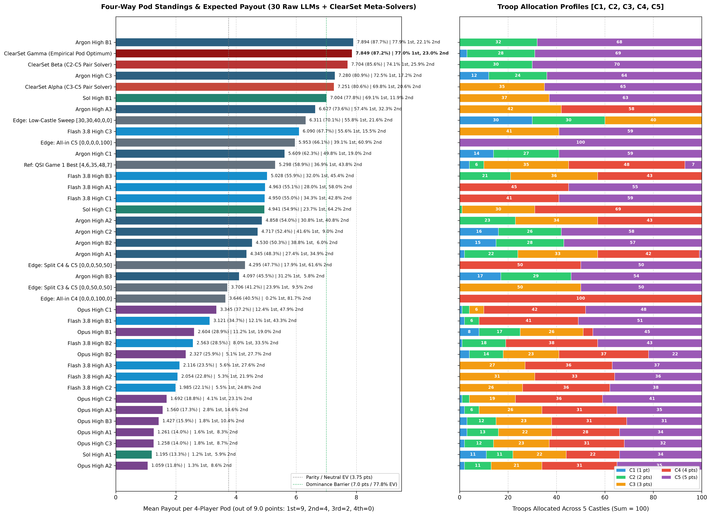
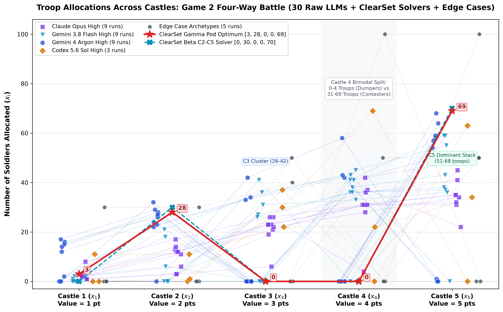

# Game 2: The Four-Way Pod Battle

> You have 100 soldiers to split across 5 castles, worth 1, 2, 3, 4 and 5 points. Whole numbers only, adding up to exactly 100. Same castles, same 100 soldiers, but now you're in a random group of 4 applicants. Each castle goes to whoever sends the most soldiers to it (tied castles split their points). Players are ranked by total castle points, and only your finish counts: 1ST: 9 PTS / 2ND: 4 PTS / 3RD: 2 PTS / 4TH: 0 PTS. Players tied in the rankings split the payouts for those places. We reshuffle the groups thousands of times and average your results.

- **Continuation**: Continued from the 2-player head-to-head empirical tournament in [[blotto]].
- **Summary**: For executive recommendations and submission trade-offs across opponent regimes, see [[submission]].

In Game 1, tournament points were additive across castles: because every matchup was head-to-head and scored strictly by castle points, linearity of expectation let us optimize each castle marginal independently with dynamic programming.

Game 2 breaks that separability completely. You no longer care about your average score on Castle 3 in a vacuum. Your payoff is determined exclusively by your relative finish within your random 4-player pod after all 5 castles are resolved:

$$
\text{Group Payout} = \frac{1}{1 + \text{Equal}} \sum_{r = \text{Higher}}^{\text{Higher} + \text{Equal}} \text{Payout}[r]
$$

where $\text{Payout} = [9.0, 4.0, 2.0, 0.0]$.

This changes the math in two fundamental ways:

- **Convexity**: 1st place awards $9.0$ out of the $15.0$ total payout points distributed per pod ($60.0\%$). 2nd place pays $4.0$, 3rd place pays $2.0$, and 4th place pays $0.0$. Second and third place combined ($6.0$ pts) do not equal a single first-place finish. Maximizing expected payout means constructing hands that win pods outright rather than playing for conservative mid-table averages.
- **Threshold**: Winning Castle $c$ outright in a 4-player pod requires beating all three opponents simultaneously:
$$
x_c > \max(y_{1,c}, y_{2,c}, y_{3,c})
$$
If an allocation beats a fraction $F_c(x_c)$ of the opponent pool in head-to-head play, its probability of capturing that castle against three independent opponents drops to approximately $F_c(x_c)^3$. Spreading troops evenly across four or five castles (like $[7, 13, 20, 27, 33]$ or $[2, 11, 21, 31, 35]$) guarantees losing every single castle to concentrated bids, finishing 4th in almost every pod.

In code, across $N$ opponent submissions, we evaluate every possible 3-opponent combination $\binom{N-1}{3}$ directly without Monte Carlo noise:

```python
payout_table = [9.0, 4.0, 2.0, 0.0]
castle_pts = [0.0, 0.0, 0.0, 0.0]
for castle, value in enumerate([1, 2, 3, 4, 5]):
    soldiers = [p[castle] for p in players]
    m = max(soldiers)
    winners = [i for i, s in enumerate(soldiers) if s == m]
    for w in winners:
        castle_pts[w] += value / len(winners)
higher = sum(1 for i in range(1, 4) if castle_pts[i] > castle_pts[0])
equal = sum(1 for i in range(1, 4) if castle_pts[i] == castle_pts[0])
group_score = sum(payout_table[higher : higher + equal + 1]) / (equal + 1)
```

---

# Guaranteed Winning Hands ($p \ge 8$)

All 5 castles sum to $1 + 2 + 3 + 4 + 5 = 15$ points. Any allocation that captures $p \ge 8$ castle points mathematically guarantees sole 1st place ($9.0$ payout points) in any 4-player pod, because the remaining three players combined can earn at most $15 - 8 = 7$ points (of course, in a 4-way split where the average is $3.75$ castle points per player, hands with $6$ or $7$ castle points such as $[3, 4] = 7$ or $[2, 5] = 7$ also finish 1st whenever the remaining points are split across the other three opponents).

The 16 castle combinations that guarantee $p \ge 8$ are identical in point sum to Game 1:

```
{
  "4, 5": 9,
  "3, 5": 8,
  "3, 4, 5": 12,
  "2, 4, 5": 11,
  "1, 4, 5": 10,
  "2, 3, 5": 10,
  "1, 3, 5": 9,
  "2, 3, 4": 9,
  "1, 2, 5": 8,
  "1, 3, 4": 8,
  "2, 3, 4, 5": 14,
  "1, 3, 4, 5": 13,
  "1, 2, 4, 5": 12,
  "1, 2, 3, 5": 11,
  "1, 2, 3, 4": 10,
  "1, 2, 3, 4, 5": 15
}
```

Two immediate structural rules govern Game 2 strategy:
- **Locks**: The only two-castle combinations that guarantee 1st place outright are $[4, 5] = 9$ points and $[3, 5] = 8$ points. Both require Castle 5. Winning any two castles without Castle 5 yields at most $3 + 4 = 7$ points, which can tie or lose to a player holding Castle 5 plus Castle 2 ($5 + 2 = 7$) or Castle 5 plus Castle 3 ($5 + 3 = 8$).
- **Centrality**: If an allocation concedes both Castle 4 and Castle 5, the maximum possible points it can take is $1 + 2 + 3 = 6$ points (e.g. $[30, 30, 40, 0, 0]$), which cannot reach $8$ points and only wins a pod when the three opponents divide the remaining $9$ points among themselves.

---

# Empirical Pod Benchmark (30 Frontier LLM Submissions)

Following the same experimental design as Game 1, we fed three prompt tiers (Prompt A: Zero-Context Baseline, Prompt B: Frontier-Aware Meta Context, Prompt C: Unconstrained Subagent Debate) to our frontier reasoning models in clean context windows. We did not have Fabel 5.1 in this run; instead, we evaluated Gemini 3.8 Flash High (9 runs across Prompts A, B, and C) alongside Gemini 4 Argon High (9 runs), Claude Opus High (9 runs), and Codex 5.6 Sol High (3 runs).

Across all $N = 30$ collected submissions, every entry is evaluated against all $\binom{29}{3} = 3,654$ exact 4-player pods.

Below are the two charts tracking pod standings and troop distributions across the 30-model field:





### Model Family Performance Breakdown

#### Gemini 4 Argon High
- **Best**: Prompt B1 `[0, 32, 0, 0, 68]` (Rank 1 / 30, Mean Payout: $7.894 / 9.0$ pts, $87.7\%$ of max, $77.9\%$ 1st, $22.1\%$ 2nd, $0.0\%$ 3rd, $0.0\%$ 4th). Completely abandons Castles 1, 3, and 4 to lock Castle 5 with 68 soldiers while placing 32 on Castle 2. This locks down 7 castle points in every pod where Castle 5 is secured, ensuring it never finishes below 2nd place.
- **Runner-up**: Prompt C3 `[12, 24, 0, 0, 64]` (Rank 2 / 30, Mean Payout: $7.280 / 9.0$ pts, $72.5\%$ 1st, $17.2\%$ 2nd, $3.5\%$ 3rd, $6.8\%$ 4th).
- **Worst**: Prompt B3 `[17, 29, 0, 0, 54]` (Rank 15 / 30, Mean Payout: $4.097 / 9.0$ pts, $31.2\%$ 1st, $5.8\%$ 2nd, $52.9\%$ 3rd, $10.1\%$ 4th). Dropping Castle 5 to 54 soldiers leaves it vulnerable to the 55 to 68 Castle 5 stack cluster.

#### Codex 5.6 Sol High
- **Best**: Prompt B1 `[0, 0, 37, 0, 63]` (Rank 3 / 30, Mean Payout: $7.004 / 9.0$ pts, $77.8\%$ of max, $69.1\%$ 1st, $11.9\%$ 2nd, $15.4\%$ 3rd, $3.6\%$ 4th). Targets Castles 3 and 5 for exactly 8 points, clearing typical proportional and top-heavy one-shot model allocations. Bidding 37 on Castle 3 clears nearly all standard 3-castle spreads, while 63 on Castle 5 clears all entries except Argon B1 (68) and Argon C3 (64).
- **Contrarian**: Prompt C1 `[0, 1, 30, 69, 0]` (Rank 10 / 30, Mean Payout: $4.941 / 9.0$ pts, $23.7\%$ 1st, $64.2\%$ 2nd, $12.2\%$ 3rd, $0.0\%$ 4th). Reasoning that deep opponents crowd and split Castle 5 while countering standard $3 + 5$ and $4 + 5$ pods, this allocation abandons Castle 5 to lock Castle 4 with 69 troops (the highest Castle 4 bid in the tournament) and contest Castles 2 to 4 for 9 points. Even when Castle 3 is lost, winning Castle 4 in $100\%$ of pods guarantees $0.0\%$ 4th-place finishes.
- **Worst**: Prompt A1 `[11, 11, 22, 22, 34]` (Rank 29 / 30, Mean Payout: $1.195 / 9.0$ pts, $1.2\%$ 1st, $5.9\%$ 2nd, $42.3\%$ 3rd, $50.5\%$ 4th). Assuming no opponent distribution means no unique EV optimum, it chose the rules-only defensive minimax split that maximizes the minimum cost ($58$ soldiers) for an opponent to capture any 8-point castle bundle. In a 4-player pod, spreading troops defensively gets overtopped on Castles 3, 4, and 5 simultaneously.

#### Gemini 3.8 Flash High
- **Best**: Prompt C3 `[0, 0, 41, 0, 59]` (Rank 5 / 30, Mean Payout: $6.090 / 9.0$ pts, $67.7\%$ of max, $55.6\%$ 1st, $15.5\%$ 2nd, $23.5\%$ 3rd, $5.5\%$ 4th). Concentrates entirely on the 8-point bundle $[3, 5]$, bidding 41 on Castle 3 and 59 on Castle 5.
- **Worst**: Prompt C2 `[0, 0, 26, 36, 38]` (Rank 23 / 30, Mean Payout: $1.985 / 9.0$ pts, $5.5\%$ 1st, $24.8\%$ 2nd, $24.8\%$ 3rd, $44.9\%$ 4th). Splits troops across Castles 3, 4, and 5, leaving all three bids below the $F_c(x_c)^3$ threshold.

#### Claude Opus High
- **Best**: Prompt C1 `[1, 3, 6, 42, 48]` (Rank 16 / 30, Mean Payout: $3.345 / 9.0$ pts, $12.4\%$ 1st, $47.9\%$ 2nd, $15.8\%$ 3rd, $24.0\%$ 4th). Puts 90 soldiers on Castles 4 and 5, but 48 on Castle 5 gets beaten by the 51 to 68 cluster.
- **Worst**: Prompt A2 `[2, 11, 21, 31, 35]` (Rank 30 / 30, Mean Payout: $1.059 / 9.0$ pts, $1.3\%$ 1st, $8.6\%$ 2nd, $29.7\%$ 3rd, $60.4\%$ 4th). Clings to a 5-castle spread, finishing dead last across all 30 entries.

---

# ClearSet Candidate Solvers & Final Submission Pick

From the 30 empirical Game 2 submissions, ClearSet evaluated candidate counter-solvers across all $\binom{30}{3} = 4,060$ 3-opponent pods:

- **Gamma**: ClearSet Gamma `[3, 28, 0, 0, 69]` ($7.849 / 9.0$ EV, $87.2\%$ of max, $77.0\%$ 1st, $23.0\%$ 2nd, $0.0\%$ 3rd, $0.0\%$ 4th). Bids 69 on Castle 5 (beating all 30 model submissions outright) and 28 on Castle 2 (beating 27 of 30 models), while placing a 3-soldier probe on Castle 1 to sweep zero-bid dumpers. When Castles 1, 2, and 5 are won together, it locks $1 + 2 + 5 = 8$ points, guaranteeing sole 1st place. In pods where Castle 1 is lost, $2 + 5 = 7$ points finishes 1st or 2nd, never taking 3rd or 4th.
- **Beta**: ClearSet Beta `[0, 30, 0, 0, 70]` ($7.704 / 9.0$ EV, $85.6\%$ of max, $74.1\%$ 1st, $25.9\%$ 2nd, $0.0\%$ 3rd, $0.0\%$ 4th). Pure 2-castle $[2, 5]$ lock committing 70 troops to Castle 5 and 30 troops to Castle 2.
- **Alpha**: ClearSet Alpha `[0, 0, 35, 0, 65]` ($7.251 / 9.0$ EV, $80.6\%$ of max, $69.8\%$ 1st, $20.6\%$ 2nd, $7.1\%$ 3rd, $2.4\%$ 4th). Pure 2-castle $[3, 5]$ bundle lock committing 65 troops to Castle 5 and 35 troops to Castle 3.
- **Raw**: Gemini 4 Argon High B1 `[0, 32, 0, 0, 68]` ($7.894 / 9.0$ EV in the 30-model pool, $77.9\%$ 1st, $22.1\%$ 2nd, $0.0\%$ 3rd, $0.0\%$ 4th). Unassisted raw model winner.

### Tactical Castle-by-Castle Breakdown (ClearSet Gamma)
- **C1** ($x_1 = 3$): Beats 20 and ties 2 out of 30 submissions in pairwise matchups ($20\text{W}-2\text{T}-8\text{L}$). Across all $4,060$ 4-player pods, it wins Castle 1 outright in $1,140$ pods ($28.1\%$) and ties for the top bid in $400$ pods ($9.9\%$), averaging $0.329 / 1.0$ castle points per pod. Whenever Castle 1 is captured alongside Castles 2 and 5, Gamma locks $1 + 2 + 5 = 8$ points and guarantees sole 1st place ($9.0$ payout points).
- **C2** ($x_2 = 28$): Beats 27 and ties 1 (`Argon High B2`) out of 30 submissions pairwise ($27\text{W}-1\text{T}-2\text{L}$, trailing only `Argon High B1` at $32$ and `Argon High B3` at $29$). Wins Castle 2 outright in $2,925 / 4,060$ pods ($72.0\%$) and ties in $351$ pods ($8.6\%$), earning $1.527 / 2.0$ average castle points per pod.
- **C3** ($x_3 = 0$): Deliberately surrendered ($0\text{W}-10\text{T}-20\text{L}$ pairwise, $0.022 / 3.0$ castle pts/pod) to avoid the $26$ to $42$ troop bloodbath where three opponents collide simultaneously.
- **C4** ($x_4 = 0$): Deliberately surrendered ($0\text{W}-8\text{T}-22\text{L}$ pairwise, $0.014 / 4.0$ castle pts/pod), bypassing the $31$ to $69$ troop congestion zone.
- **C5** ($x_5 = 69$): Defeats all 30 submissions outright ($30\text{W}-0\text{T}-0\text{L}$), clearing `Argon High B1` ($68$), `Argon High C3` ($64$), and `Sol High B1` ($63$). Wins Castle 5 in $100.0\%$ of pods ($4,060 / 4,060$, $5.000 / 5.0$ castle pts/pod), establishing a 5-point floor in every pod that eliminates 3rd- and 4th-place finishes ($0.0\%$ 3rd, $0.0\%$ 4th).

### Validation & Robustness
- **Perturbation**: Under $\pm 1$ to $\pm 3$ soldier trembling-hand noise per castle across $5,000$ Monte Carlo pod trials against the 30-model pool, ClearSet Gamma maintains a $74.1\%$ to $77.0\%$ 1st-place rate ($7.633$ to $7.849 / 9.0$ EV) and scores $7.399$ to $8.203 / 9.0$ EV across all four out-of-sample folds in Leave-One-Family-Out cross-validation (see Appendix D).
- **Floor**: Because $x_5 = 69$ clears the 30-model distribution with a 1- to 6-soldier buffer over the top contenders, Gamma never finishes 3rd or 4th in any unperturbed pod.

### Key Prompt Takeaways
- **Baseline**: Under Prompt A zero-context baseline, models that spread troops across 4 or 5 castles (`Opus High A2` `[2, 11, 21, 31, 35]` and `Sol High A1` `[11, 11, 22, 22, 34]`) get crushed by the $F_c(x_c)^3$ pod threshold, finishing 29th and 30th with over $50\%$ 4th-place finishes.
- **Frontier**: Under Prompt B frontier-aware context, top models immediately compress into 2-castle locks targeting $[2, 5]$ (`Argon High B1` `[0, 32, 0, 0, 68]`) or $[3, 5]$ (`Sol High B1` `[0, 0, 37, 0, 63]`).
- **Debate**: Under Prompt C subagent debate, models either escalate Castle 5 bids to $59$ to $64$ (`Argon High C3`, `Flash 3.8 High C3`) or pivot into contrarian Castle 4 locks (`Sol High C1` `[0, 1, 30, 69, 0]`, which secures $0.0\%$ 4th-place finishes but caps 1st place at $23.7\%$).

---

# Appendices

## Appendix A: Code
The Game 2 simulation engines, benchmark runners, and plotting pipelines are:
- [`benchmarks/pod_game_simulator.py`](file:///home/arika/D/gh/sequoiacap-pokebot/benchmarks/pod_game_simulator.py): Exhaustive $\binom{N-1}{3}$ 4-player pod combinatorial simulator and candidate evaluator.
- [`benchmarks/run_live_game2_benchmark.py`](file:///home/arika/D/gh/sequoiacap-pokebot/benchmarks/run_live_game2_benchmark.py): Live evaluation harness across Prompt A, B, and C in clean context windows.
- [`evaluations/verify_game2_robustness.py`](file:///home/arika/D/gh/sequoiacap-pokebot/evaluations/verify_game2_robustness.py): Castle-by-castle pod breakdown, Leave-One-Family-Out cross-validation, and Monte Carlo trembling-hand noise suite.
- [`evaluations/audit_blotto_doc.py`](file:///home/arika/D/gh/sequoiacap-pokebot/evaluations/audit_blotto_doc.py): Deterministic autograder verifying all Game 1 and Game 2 metrics, 5-tuple sums, and solver evaluations.
- [`evaluations/render_game2_chart.py`](file:///home/arika/D/gh/sequoiacap-pokebot/evaluations/render_game2_chart.py): Generates [`blotto2_scores_chart.png`](file:///home/arika/D/gh/sequoiacap-pokebot/blotto2_scores_chart.png) (mean payouts, finish shares, stacked allocation profiles).
- [`evaluations/render_game2_scatter_chart.py`](file:///home/arika/D/gh/sequoiacap-pokebot/evaluations/render_game2_scatter_chart.py): Generates [`castle_allocations_scatter2.png`](file:///home/arika/D/gh/sequoiacap-pokebot/castle_allocations_scatter2.png) (scatter plot with family markers, jitter, and strategic threshold annotations).

## Appendix B: Game 2 Prompts
The following prompts were fed to all models in clean context windows:
```
  ### Prompt A: Base Contest Prompt (Zero-Context Baseline)

    You have 100 soldiers to split across 5 castles, worth 1, 2, 3, 4 and 5 points. Whole numbers only, adding up to exactly 100.
    GAME: FOUR-WAY BATTLE
    You are placed in a random group of 4 applicants. Each castle goes to whoever sends the most soldiers to it (tied castles split their points).
    Players are ranked by total castle points, and only your finish in the group of 4 counts:
    1ST: 9 PTS / 2ND: 4 PTS / 3RD: 2 PTS / 4TH: 0 PTS
    Players tied in the rankings split the payouts for those places. The groups are reshuffled thousands of times and your final score is your average payout across all groups.
    Provide your concise strategic reasoning and your final integer allocation [C1, C2, C3, C4, C5] summing to 100.

  ### Prompt B: Frontier-Opponent Prompt (Single-Turn Meta Context)

    You have 100 soldiers to split across 5 castles, worth 1, 2, 3, 4 and 5 points. Whole numbers only, adding up to exactly 100.
    GAME: FOUR-WAY BATTLE
    You are placed in a random group of 4 applicants. Each castle goes to whoever sends the most soldiers to it (tied castles split their points).
    Players are ranked by total castle points, and only your finish in the group of 4 counts:
    1ST: 9 PTS / 2ND: 4 PTS / 3RD: 2 PTS / 4TH: 0 PTS
    Players tied in the rankings split the payouts for those places. The groups are reshuffled thousands of times and your final score is your average payout across all groups.

    IMPORTANT META CONTEXT: Most other applicants in this tournament are using top frontier reasoning LLMs (such as Claude Opus 5.5, Gemini 4
    Argon, Gemini 3.8 Flash, Codex 5.6 Sol, o3) to generate their single submission, alongside a smaller fraction of human players. Maximize your
    expected average score against this specific opponent field. Provide your concise strategic reasoning and your final integer allocation
    [C1, C2, C3, C4, C5] summing to 100.

  ### Prompt C: Unconstrained Subagent Debate Prompt (Clean Context Window)

    You have 100 soldiers to split across 5 castles, worth 1, 2, 3, 4 and 5 points. Whole numbers only, adding up to exactly 100.
    GAME: FOUR-WAY BATTLE
    You are placed in a random group of 4 applicants. Each castle goes to whoever sends the most soldiers to it (tied castles split their points).
    Players are ranked by total castle points, and only your finish in the group of 4 counts:
    1ST: 9 PTS / 2ND: 4 PTS / 3RD: 2 PTS / 4TH: 0 PTS
    Players tied in the rankings split the payouts for those places. The groups are reshuffled thousands of times and your final score is your average payout across all groups.

    IMPORTANT META & SUBAGENT DEBATE CONTEXT: Most other applicants in this tournament are using top frontier reasoning LLMs (such as Claude Opus 5.5,
    Gemini 4 Argon, Gemini 3.8 Flash, Codex 5.6 Sol, o3) AND are conducting multi-turn discussions and adversarial subagent debates to counter
    predictable Level-1 LLM plays.
    Think deeply with no token limit. You may simulate or invoke adversarial subagents to debate competing philosophies (e.g., high-variance 1st-place
    9-point pod dominance vs. empirical step-threshold exploitation against 3 simultaneous opponents vs. defensive parity).
    Taking into account the realistic mixture of 1-shot LLM users, multi-turn LLM users who anticipate Level-1 counters, and human players, what is the
    single highest-EV integer allocation [C1, C2, C3, C4, C5] summing to 100?
```

## Appendix C: Standings Table (Game 2 Four-Way Pod Benchmark)
Exhaustive 4-player pod evaluation across all 30 frontier LLM submissions ($\binom{29}{3} = 3,654$ exact pods per entry, maximum $9.0$ points per pod, neutral expected value $\frac{9+4+2+0}{4} = 3.750$):

| Rank | Model / Entry | Allocation | Mean Payout (out of 9.0) | 1st % | 2nd % | 3rd % | 4th % |
| :--- | :------------ | :--------- | :----------------------- | :---- | :---- | :---- | :---- |
| 1 | Argon High B1 | `[0, 32, 0, 0, 68]` | 7.894 (87.7%) | 77.9% | 22.1% | 0.0% | 0.0% |
| 2 | Argon High C3 | `[12, 24, 0, 0, 64]` | 7.280 (80.9%) | 72.5% | 17.2% | 3.5% | 6.8% |
| 3 | Sol High B1 | `[0, 0, 37, 0, 63]` | 7.004 (77.8%) | 69.1% | 11.9% | 15.4% | 3.6% |
| 4 | Argon High A3 | `[0, 0, 42, 58, 0]` | 6.627 (73.6%) | 57.4% | 32.3% | 8.5% | 1.8% |
| 5 | Flash 3.8 High C3 | `[0, 0, 41, 0, 59]` | 6.090 (67.7%) | 55.6% | 15.5% | 23.5% | 5.5% |
| 6 | Argon High C1 | `[14, 27, 0, 0, 59]` | 5.609 (62.3%) | 49.8% | 19.0% | 18.1% | 13.0% |
| 7 | Flash 3.8 High B3 | `[0, 21, 36, 43, 0]` | 5.028 (55.9%) | 32.0% | 45.4% | 16.6% | 6.0% |
| 8 | Flash 3.8 High A1 | `[0, 0, 0, 45, 55]` | 4.963 (55.1%) | 28.0% | 58.0% | 6.1% | 7.8% |
| 9 | Flash 3.8 High C1 | `[0, 0, 0, 41, 59]` | 4.950 (55.0%) | 34.3% | 42.8% | 7.8% | 15.2% |
| 10 | Sol High C1 | `[0, 1, 30, 69, 0]` | 4.941 (54.9%) | 23.7% | 64.2% | 12.2% | 0.0% |
| 11 | Argon High A2 | `[0, 23, 34, 43, 0]` | 4.858 (54.0%) | 30.8% | 40.8% | 22.7% | 5.7% |
| 12 | Argon High C2 | `[16, 26, 0, 0, 58]` | 4.717 (52.4%) | 41.6% | 9.0% | 30.7% | 18.7% |
| 13 | Argon High B2 | `[15, 28, 0, 0, 57]` | 4.530 (50.3%) | 38.8% | 6.0% | 39.9% | 15.3% |
| 14 | Argon High A1 | `[2, 22, 33, 42, 1]` | 4.345 (48.3%) | 27.4% | 34.9% | 24.1% | 13.6% |
| 15 | Argon High B3 | `[17, 29, 0, 0, 54]` | 4.097 (45.5%) | 31.2% | 5.8% | 52.9% | 10.1% |
| 16 | Opus High C1 | `[1, 3, 6, 42, 48]` | 3.345 (37.2%) | 12.4% | 47.9% | 15.8% | 24.0% |
| 17 | Flash 3.8 High B1 | `[2, 6, 0, 41, 51]` | 3.121 (34.7%) | 12.1% | 43.3% | 15.0% | 29.6% |
| 18 | Opus High B1 | `[8, 17, 26, 4, 45]` | 2.604 (28.9%) | 11.2% | 19.0% | 42.0% | 27.9% |
| 19 | Flash 3.8 High B2 | `[1, 18, 0, 38, 43]` | 2.563 (28.5%) | 8.0% | 33.5% | 25.0% | 33.5% |
| 20 | Opus High B2 | `[4, 14, 23, 37, 22]` | 2.327 (25.9%) | 5.1% | 27.7% | 37.8% | 29.3% |
| 21 | Flash 3.8 High A3 | `[0, 0, 27, 36, 37]` | 2.116 (23.5%) | 5.6% | 27.6% | 25.5% | 41.3% |
| 22 | Flash 3.8 High A2 | `[0, 0, 31, 33, 36]` | 2.054 (22.8%) | 5.3% | 21.9% | 35.1% | 37.7% |
| 23 | Flash 3.8 High C2 | `[0, 0, 26, 36, 38]` | 1.985 (22.1%) | 5.5% | 24.8% | 24.8% | 44.9% |
| 24 | Opus High C2 | `[1, 3, 19, 36, 41]` | 1.692 (18.8%) | 4.1% | 23.1% | 19.7% | 53.0% |
| 25 | Opus High A3 | `[2, 6, 26, 31, 35]` | 1.560 (17.3%) | 2.8% | 14.6% | 36.2% | 46.4% |
| 26 | Opus High B3 | `[3, 12, 23, 31, 31]` | 1.427 (15.9%) | 1.8% | 10.4% | 42.4% | 45.4% |
| 27 | Opus High A1 | `[3, 13, 22, 28, 34]` | 1.261 (14.0%) | 1.6% | 8.3% | 39.4% | 50.7% |
| 28 | Opus High C3 | `[2, 12, 23, 31, 32]` | 1.258 (14.0%) | 1.8% | 8.7% | 37.3% | 52.2% |
| 29 | Sol High A1 | `[11, 11, 22, 22, 34]` | 1.195 (13.3%) | 1.2% | 5.9% | 42.3% | 50.5% |
| 30 | Opus High A2 | `[2, 11, 21, 31, 35]` | 1.059 (11.8%) | 1.3% | 8.6% | 29.7% | 60.4% |

### Counter-Solver Performance vs All 30 Submissions ($\binom{30}{3} = 4,060$ Pods)

| Solver | Allocation | Mean Payout (out of 9.0) | 1st % | 2nd % | 3rd % | 4th % | Methodology / Mechanism |
| :--- | :--- | :--- | :--- | :--- | :--- | :--- | :--- |
| Gamma | `[3, 28, 0, 0, 69]` | 7.849 (87.2%) | 77.0% | 23.0% | 0.0% | 0.0% | Combinatorial pod threshold optimizer over all 4,060 3-opponent pods. Beats all 30 models on Castle 5 ($x_5 = 69$) and 27 of 30 on Castle 2 ($x_2 = 28$), while probing Castle 1 ($x_1 = 3$) to lock $1 + 2 + 5 = 8$ points when zero-bidders collide. |
| Beta | `[0, 30, 0, 0, 70]` | 7.704 (85.6%) | 74.1% | 25.9% | 0.0% | 0.0% | Pure 2-castle $[2, 5]$ pod lock ($x_2 = 30, x_5 = 70$) guaranteeing $\ge 5$ castle points and $0.0\%$ 3rd/4th finishes. |
| Alpha | `[0, 0, 35, 0, 65]` | 7.251 (80.6%) | 69.8% | 20.6% | 7.1% | 2.4% | Pure 2-castle $[3, 5]$ 8-point bundle lock ($x_3 = 35, x_5 = 65$). |

## Appendix D: Out-of-Sample Cross-Validation, Noise Stress Tests, and Edge Cases

### 1. Leave-One-Family-Out (LOFO) Cross-Validation
To check whether our pod threshold optimization generalizes across model families rather than memorizing specific bids, we held out each of the 4 model families in turn. For each fold, we optimized a candidate strictly over the remaining training submissions ($\binom{N_{\text{train}}}{3}$ pods) and evaluated both the fold-trained candidate and ClearSet Gamma (`[3, 28, 0, 0, 69]`) across all out-of-sample pods containing at least one held-out family submission ($\binom{30}{3} - \binom{N_{\text{train}}}{3}$ pods):

| Held-Out Model Family | Test Entries ($N$) | Out-of-Sample Pods | Trained Pod Allocation | Train EV (out of 9.0) | Trained OOS EV (1st%) | Gamma `[3, 28, 0, 0, 69]` OOS EV (1st%) |
| :--- | :--- | :--- | :--- | :--- | :--- | :--- |
| Gemini 4 Argon High | 9 | 2,730 | `[12, 24, 0, 0, 64]` | 9.000 / 9.0 | 5.822 (50.1%) | 7.399 (68.0%) |
| Gemini 3.8 Flash High | 9 | 2,730 | `[1, 30, 0, 0, 69]` | 7.299 / 9.0 | 8.037 (80.7%) | 8.203 (84.1%) |
| Claude Opus High | 9 | 2,730 | `[1, 30, 0, 0, 69]` | 7.820 / 9.0 | 7.783 (75.7%) | 7.928 (78.6%) |
| Codex 5.6 Sol High | 3 | 1,135 | `[3, 28, 0, 0, 69]` | 7.785 / 9.0 | 8.013 (80.3%) | 8.013 (80.3%) |

Holding out Gemini 4 Argon High exposes the primary tail risk in 4-player pods: without Argon in the training pool, the highest Castle 5 bid is Sol High B1's $63$, so a naive empirical optimizer stops at $x_5 = 64$ (`[12, 24, 0, 0, 64]`, which scores a perfect $9.000 / 9.0$ in-sample) and then drops to $5.822$ EV out-of-sample when colliding with Argon High B1 ($68$) and Argon High C3 ($64$). By contrast, holding out Flash 3.8, Opus, or Sol immediately recovers the $x_5 = 69$ Castle 5 lock (`[1, 30, 0, 0, 69]` and `[3, 28, 0, 0, 69]`), and ClearSet Gamma maintains $7.399$ to $8.203 / 9.0$ EV across all four held-out folds.

### 2. Monte Carlo Trembling-Hand Noise Across All 30 Models
To stress-test sensitivity against opponent perturbations in 4-player pods, we executed $5,000$ Monte Carlo pod trials per noise level across the 30-model pool under uniform integer noise $\epsilon \in \{0, \pm 1, \pm 2, \pm 3\}$ per castle (preserving $\sum_{i=1}^5 x_i = 100$ and $x_i \ge 0$, and excluding self-matchups for in-pool entries):

| Candidate | $\epsilon = 0$ EV (1st%) | $\epsilon = \pm 1$ EV (1st%) | $\epsilon = \pm 2$ EV (1st%) | $\epsilon = \pm 3$ EV (1st%) |
| :--- | :--- | :--- | :--- | :--- |
| ClearSet Gamma `[3, 28, 0, 0, 69]` | 7.849 (77.0%) | 7.677 (74.3%) | 7.723 (75.4%) | 7.633 (74.1%) |
| ClearSet Beta `[0, 30, 0, 0, 70]` | 7.704 (74.1%) | 7.608 (72.2%) | 7.662 (73.3%) | 7.667 (73.5%) |
| ClearSet Alpha `[0, 0, 35, 0, 65]` | 7.251 (69.8%) | 7.207 (69.4%) | 7.205 (69.4%) | 7.174 (68.9%) |
| Argon High B1 `[0, 32, 0, 0, 68]` | 7.894 (77.9%) | 7.870 (77.4%) | 7.872 (77.4%) | 7.913 (78.3%) |
| Sol High B1 `[0, 0, 37, 0, 63]` | 7.004 (69.1%) | 7.190 (71.2%) | 7.211 (71.4%) | 7.213 (71.5%) |

While ClearSet Gamma `[3, 28, 0, 0, 69]` leads all external counter-solvers at $\epsilon = 0$, $\epsilon = \pm 1$, and $\epsilon = \pm 2$, ClearSet Beta `[0, 30, 0, 0, 70]` slightly edges it at $\epsilon = \pm 3$ ($7.667$ vs $7.633$ EV) because $x_5 = 70$ and $x_2 = 30$ provide extra buffer when opponent bids jitter upward by up to 3 troops.

### 3. Edge Cases and Ex-Post QSI Comparison in 4-Player Pods
Evaluating the five edge-case archetypes alongside QSI Labs' Game 1 leaderboard allocation (`[4, 6, 35, 48, 7]` from [`1794189896498.pdf`](file:///home/arika/D/media/blotto_game/1794189896498.pdf)) against the 30-model Game 2 field shows how severely the 4-player pod structure punishes non-Castle-5 strategies:

| Archetype | Allocation | Mean Payout (out of 9.0) | 1st % | 2nd % | 3rd % | 4th % |
| :--- | :--- | :--- | :--- | :--- | :--- | :--- |
| Low-Castle Sweep | `[30, 30, 40, 0, 0]` | 6.311 (70.1%) | 55.8% | 21.6% | 21.2% | 1.4% |
| All-in Castle 5 | `[0, 0, 0, 0, 100]` | 5.953 (66.1%) | 39.1% | 60.9% | 0.0% | 0.0% |
| QSI Labs Game 1 Best | `[4, 6, 35, 48, 7]` | 5.298 (58.9%) | 36.9% | 43.8% | 11.3% | 8.0% |
| Split on C4 & C5 | `[0, 0, 0, 50, 50]` | 4.295 (47.7%) | 17.9% | 61.6% | 11.1% | 9.4% |
| Split on C3 & C5 | `[0, 0, 50, 0, 50]` | 3.706 (41.2%) | 23.9% | 9.5% | 58.8% | 7.8% |
| All-in Castle 4 | `[0, 0, 0, 100, 0]` | 3.646 (40.5%) | 0.2% | 81.7% | 18.2% | 0.0% |

- **Sweep**: `[30, 30, 40, 0, 0]` earns $6.311 / 9.0$ EV ($55.8\%$ 1st) because so many frontier models abandon Castles 1, 2, and 3 completely, allowing 6 castle points to take 1st whenever the other 9 points splinter across three opponents.
- **QSI**: While `[4, 6, 35, 48, 7]` was near-optimal in Game 1 linear head-to-head play, in Game 2 its 7 soldiers on Castle 5 lose Castle 5 in $100\%$ of pods, capping its 1st-place rate at $36.9\%$ ($5.298 / 9.0$ EV).
